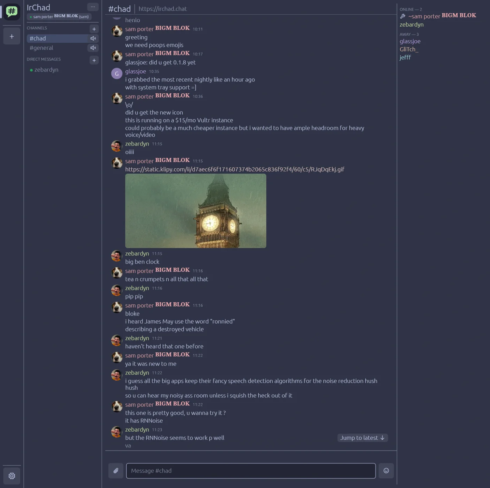

<div align="center">


# IrChad

**A Discord-style client for IRC, with voice, screen share and encrypted DMs.**<br>
Paste an invite link and you're in. No server lists, no NickServ, and you host it yourself.

[](https://git.gentoo.party/sam/irchad-ng/releases)
[](https://git.gentoo.party/sam/irchad-ng/actions?workflow=ci.yaml)
[](LICENSE)
[](https://www.rust-lang.org)
[](https://web.libera.chat/#irchad)


[**Website**](https://irchad.chat) ·
[**Try it in your browser**](https://irchad.chat/chat/) ·
[**Install**](#install) ·
[**Docs**](https://irchad.chat/docs) ·
[**Host a network**](#host-a-network) ·
[**Chat with us**](#community)

<br>

<a href="site/public/screenshot.webp"></a>

</div>

## What you get

<table>
<tr>
<td width="50%" valign="top">

### 🔗 Paste a link, start chatting

An invite URL carries the whole network config. Log in and you're in your channels.

</td>
<td width="50%" valign="top">

### 🎙️ Voice in every channel

Click a channel's speaker and you're talking. PipeWire-native, with push-to-talk that works on Wayland.

</td>
</tr>
<tr>
<td valign="top">

### 🖥️ Screen share with audio

Share a screen or a window, sound included, on Wayland, X11 and Windows. Hardware encoding when your GPU has it.

</td>
<td valign="top">

### 🔐 Encrypted DMs

Olm double ratchet. Verify each other's devices by comparing emoji. The server never sees the plaintext.

</td>
</tr>
<tr>
<td valign="top">

### 💬 It's still IRC

Text is IRCv3 on [ergo](https://github.com/ergochat/ergo). People on plain IRC clients see a normal channel, and IrChad's extras fall back to readable text.

</td>
<td valign="top">

### 🏠 You host it

One compose file runs ergo, LiveKit and chadd behind Caddy, on your own server. No paid tiers, no ads, no tracking.

</td>
</tr>
</table>

Also: replies, reactions and typing indicators, server-side history with synced read markers, an emoji picker and GIF search, uploads and link previews, a soundboard, per-app audio in screen shares, several networks at once, and a game overlay. The [website](https://irchad.chat/#all-features) has the full table.

## Install

### Linux (x86_64)

```sh
curl -fsSL https://irchad.chat/install.sh | sh
```

It installs for your user only, with no root: the app in `~/.local/bin`, its menu entry, and the handler for invite links. The app updates itself after that.
Add `-s -- --nightly` after `sh` for a build of `main`, or `-s -- --uninstall` to remove it.

Prefer to do it by hand? Download the [tarball](https://downloads.gentoo.party/irchad/latest/irchad-linux-x86_64.tar.gz), unpack it and run `irchad/install.sh`.

<details>
<summary><b>Gentoo:</b> there's an overlay</summary>

```sh
eselect repository add irchad git https://git.gentoo.party/sam/irchad-overlay.git
emaint sync -r irchad
emerge -av net-im/irchad
```

</details>

### Windows (x86_64)

Run the [installer](https://downloads.gentoo.party/irchad/latest/irchad-windows-x86_64-setup.exe). It installs for your user, with no admin prompt, and the app updates itself.

### Mobile

**Android** is in progress (voice and watching screen shares work). Install the [APK](https://downloads.gentoo.party/irchad/latest/irchad-android-arm64.apk), or add it to Obtainium to get updates:

<a href="https://apps.obtainium.imranr.dev/redirect?r=obtainium%3A%2F%2Fapp%2F%7B%22id%22%3A%22party.gentoo.irchad%22%2C%22url%22%3A%22https%3A%2F%2Fgit.gentoo.party%2Fsam%2Firchad-ng%22%2C%22author%22%3A%22sam%22%2C%22name%22%3A%22IrChad%22%2C%22overrideSource%22%3A%22Codeberg%22%2C%22additionalSettings%22%3A%22%7B%5C%22includePrereleases%5C%22%3Afalse%7D%22%7D"></a>

**iOS:** not released yet.

### Nightly builds

Builds of `main`, rebuilt each night when it has changed. Expect some breakage.

| Platform | Download |
|---|---|
| Linux | [tarball](https://downloads.gentoo.party/irchad/nightly/irchad-linux-x86_64.tar.gz) |
| Windows | [installer](https://downloads.gentoo.party/irchad/nightly/irchad-windows-x86_64-setup.exe) |
| Everything | [release page](https://git.gentoo.party/sam/irchad-ng/releases/tag/nightly) |

## Host a network

An IrChad network has four parts:

| Part | What it does |
|---|---|
| [**ergo**](https://github.com/ergochat/ergo) (≥ 2.19) | The IRC server. IrChad only supports ergo. |
| [**LiveKit**](https://livekit.io) | Carries voice and screen share. |
| **chadd** | A small server for discovery, login, voice tokens and uploads. |
| [**Caddy**](https://caddyserver.com) | Serves all of them over one HTTPS origin. |

[`deploy/`](deploy/) has a compose file for all four:

```sh
docker compose -f deploy/compose.yaml up -d --build   # podman compose works too
python3 deploy/seed.py                                # test accounts and channels
```

It's a dev stack, so replace every secret in it before you expose it. Admins manage the network with any normal IRC client; there is no admin UI yet.

## Build from source

```sh
cargo run -p chad-desktop   # the binary is called irchad
```

It's one Cargo workspace (Rust, edition 2024). The desktop UI is egui on wgpu, IRC is our own `chad-irc` crate over WebSocket, and media goes through the LiveKit Rust SDK. Building the media crate needs clang ≥ 21 and PipeWire headers.

[docs/ARCHITECTURE.md](docs/ARCHITECTURE.md) describes the design, [docs/decisions.md](docs/decisions.md) records why, and [docs/PLAN.md](docs/PLAN.md) is the roadmap.

## Community

- **IRC:** [`#irchad` on Libera.Chat](https://web.libera.chat/#irchad) (`ircs://irc.libera.chat:6697/#irchad`)
- **The official IrChad network:** [get the app and join](https://irchad.chat/invite), or [join in your browser](https://irchad.chat/chat/)
- **Source and issues:** [git.gentoo.party/sam/irchad-ng](https://git.gentoo.party/sam/irchad-ng)

## License

[GPL-3.0-or-later](LICENSE).

<div align="center">
<sub>IRC never died. It just needed a speaker icon.</sub>
</div>
